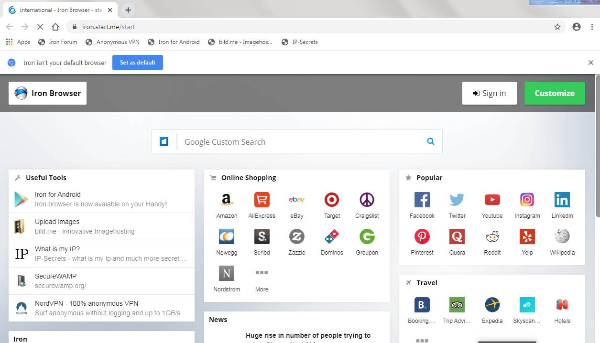
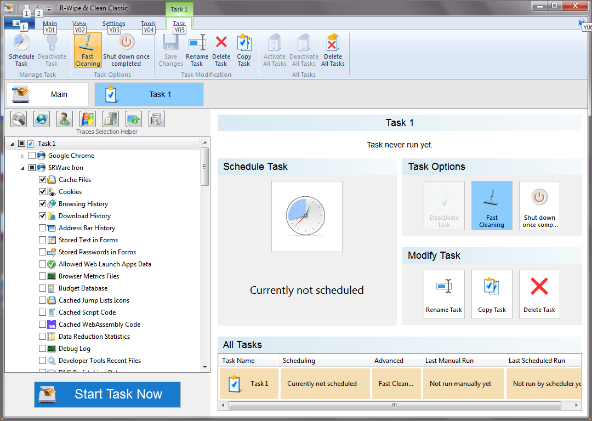

# SRWare Iron Privacy-Focused Chromium Web Browser

SRWare Iron is a Chromium-based browser that combines Blink performance, modern web compatibility, extension support and privacy-oriented defaults.

[](https://github.com/sr-iron-browser/srware-iron/releases/)

## Features

- Chromium-based browsing with Blink performance.
- Reduced telemetry and background communication.
- No installation ID, RLZ tracking or automatic query transmission.
- Chrome-compatible extensions and developer tools.
- Privacy controls for suggestions, error reporting and URL tracking.
- Versions for Windows, macOS, Linux and Android.
- Portable packages for supported Windows architectures.



## Supported platforms

SRWare Iron is available for:

- Windows 10 and 11
- Windows 7 and 8 legacy systems
- macOS on Intel and Apple Silicon
- Debian, Ubuntu and Mint
- Android

The browser includes separate packages for desktop architectures and portable Windows installations.

## Privacy-focused browsing

SRWare Iron is designed to keep routine browsing data on the user's device. Features that can transmit partial queries, keywords, metrics or diagnostic information to central services are disabled or require user consent.

The browser follows the Chromium interface and rendering model while giving users more control over background requests and privacy-related behavior.

## Privacy controls

Depending on the platform and version, the privacy model addresses:

- Installation identifiers
- Search and address-bar suggestions
- Alternate error pages
- Crash and error reporting
- RLZ tracking
- Background URL tracking



## Building and development

SRWare Iron is distributed primarily through binary packages and source archives. Chromium-based development requires a compatible compiler, Python, GN, Ninja, Node.js and platform development libraries.

A Chromium-derived build can be prepared with the following environment variables:

```bash
export CC=gcc
export CXX=g++
export AR=ar
export NM=nm
```

After the build directory has been generated, compile the browser with Ninja:

```bash
gn gen out
ninja -C out chrome
```

The exact build arguments and dependencies depend on the target operating system and Chromium version.

## Downloads and support

SRWare Iron provides installers and portable packages for supported desktop and mobile platforms. Users should review browser settings after installation and keep the browser updated.

Community questions, troubleshooting and bug reports can be handled through the project's support channels.

## Related Search Terms

srware iron, sr ware iron, srware browser, sr iron browser, swiron browser, chromium browser, privacy browser, chromium privacy, browser telemetry, chrome alternative, browser extensions, portable browser, web browser security, cross-platform browser
